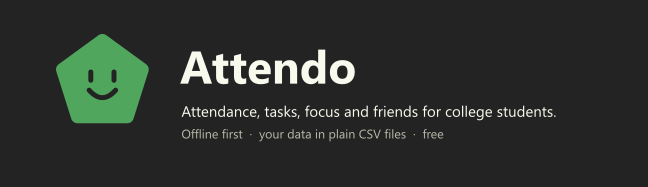
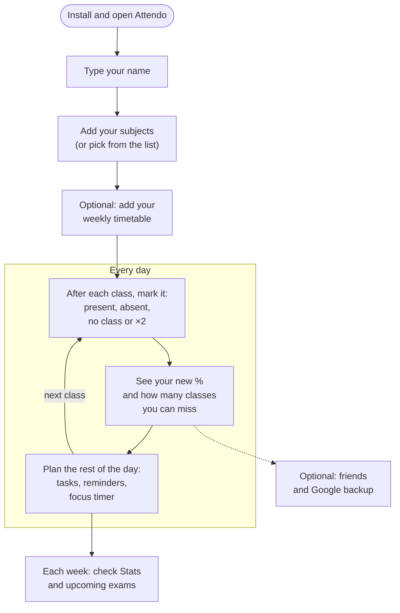
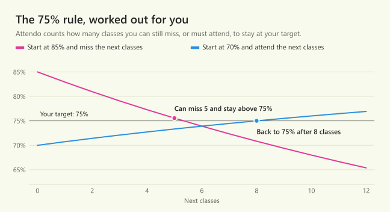
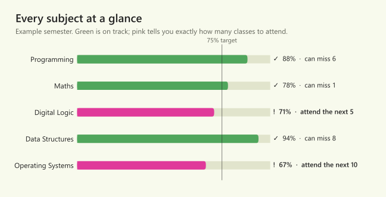
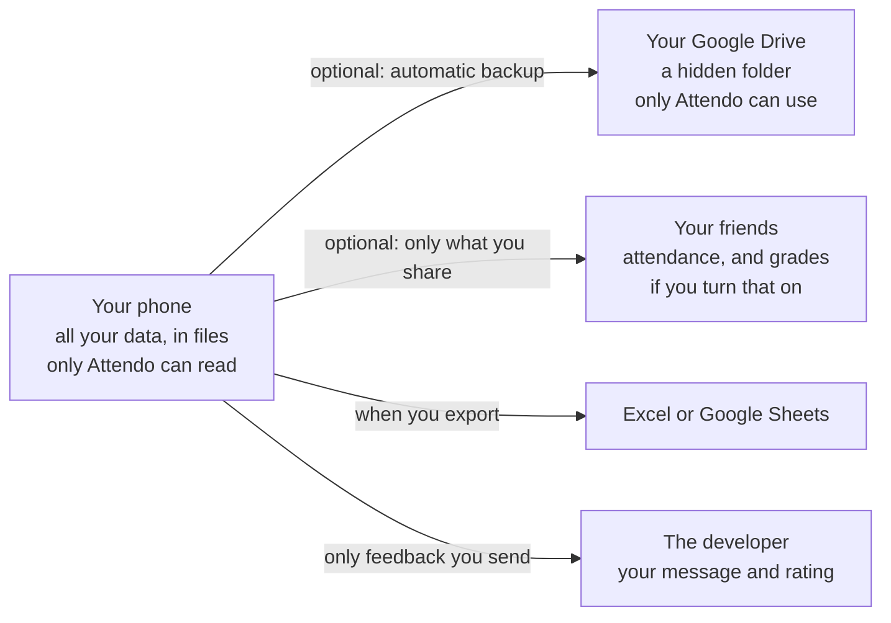

<p align="center">
  
</p>

<p align="center">
  
  
  
  
</p>

<p align="center">
  <a href="#what-you-can-do"><b>Features</b></a> ·
  <a href="#how-it-works"><b>How it works</b></a> ·
  <a href="#know-where-you-stand"><b>Charts</b></a> ·
  <a href="#get-the-app"><b>Get the app</b></a> ·
  <a href="#your-privacy"><b>Privacy</b></a> ·
  <a href="#questions"><b>Questions</b></a>
</p>

---

## What is Attendo?

Attendo is a free Android app that keeps track of your class attendance for every subject. You
don't have to do the maths: it tells you, in plain numbers, **how many classes you can still miss**
or **how many you must attend** to stay above your college's minimum (usually 75%).

It also helps with the rest of student life: a to-do board, reminders, a focus timer, your
syllabus, your timetable and exam dates, your marks, and friends who keep each other on track.

Everything works **without internet**, and your data stays **on your phone** in simple files you
can open in Excel or Google Sheets.

## What you can do

### Attendance
- **Mark a class in one tap**: present, absent, or ×2 for a double class. Prefer swiping? Turn on
  **Tinder mode** in the Classes tab and flick each subject's card: right for *present*, left for *absent*, down for
  *no class*, up for a *double class*.
- **See your percentage for every subject**, and how it compares with your target.
- **Know your limits.** "You can miss 3 more" or "attend the next 5" appears for every subject,
  plus how things will look by the end of the course.
- **A little green mascot** whose mood follows your attendance: it bounces when you're on track
  and sways when you fall behind.
- **Fix mistakes easily.** Go back to any day and change what you marked.

### Plan your days
- **Timetable.** Enter your weekly classes once. Home then shows what's *now* and *next*.
- **Calendar.** The academic calendar with holidays and exams is built in. Add your own tests,
  deadlines and events, and tap any day to see everything on it.
- **Tasks.** Three ways to stay organised: a weekday **checklist** for habits, a **board** with
  columns for bigger work, and **reminders** that notify you at the time you pick.

### Study better
- **Focus timer.** A Pomodoro-style timer with an animated dial. Pick the subject you're studying
  and see how much you focused this week.
- **Syllabus.** Every unit of every course, with topics and outcomes. Tick off units as they're
  covered and watch your progress.
- **Grades.** Add your test and assignment marks to see your standing in each subject. They stay
  private unless you choose to share them.

### Stay on track together
- **Friends.** Sign in with Google, find classmates by name or friend code, and send a request.
  Friends can see each other's attendance, and grades only if you turn that on.

### Make it yours
- **Seven themes**, including dark mode and your own colours.
- **Animation styles:** smooth, iPhone-like, classic Android, or none at all.
- **Your own launch picture**, shown when the app opens.

### Tell us what you think
- **Send feedback** from Settings: rate the app, report a problem or share an idea. You get a
  reference code, and it still goes out later if you're offline.
- **Clear error messages.** Every problem the app reports ends with a short code (like `FR-404`)
  that's easy to quote.

### Keep your data safe
- **Automatic Google backup** to a hidden folder in your own Google Drive, and restore on a new
  phone.
- **Export to CSV** to keep a copy, or open your data in Excel. Restore from those files at any
  time.

## How it works



The app has five tabs at the bottom:

| Tab | What it's for |
|---|---|
| **Home** | Your day at a glance: attendance, the next class, today's tasks and upcoming exams |
| **Classes** | Mark attendance, see each subject's numbers, add subjects |
| **Tasks** | Checklist, board and reminders |
| **Timer** | Focus timer, your syllabus and your study stats |
| **Stats** | Attendance and grades for every subject, side by side |

## Know where you stand

Attendo does the attendance maths for you. Both charts below use example numbers and the app's
own formulas.

<picture>
  <source media="(prefers-color-scheme: dark)" srcset="docs/images/chart-75-rule-dark.svg">
  
</picture>

<details>
<summary>See the numbers</summary>

| Next classes | Start at 85% and miss them | Start at 70% and attend them |
|---:|---:|---:|
| 0 | 85.0% | 70.0% |
| 2 | 81.0% | 71.4% |
| 4 | 77.3% | 72.7% |
| 5 | **75.6%** (last one above 75%) | 73.3% |
| 6 | 73.9% | 73.9% |
| 8 | 70.8% | **75.0%** (target reached) |
| 10 | 68.0% | 76.0% |
| 12 | 65.4% | 76.9% |

</details>

<picture>
  <source media="(prefers-color-scheme: dark)" srcset="docs/images/chart-subjects-dark.svg">
  
</picture>

<details>
<summary>See the numbers</summary>

| Subject | Attended | Held | Attendance | What Attendo tells you |
|---|---:|---:|---:|---|
| Programming | 30 | 34 | 88% | can miss 6 |
| Maths | 25 | 32 | 78% | can miss 1 |
| Digital Logic | 22 | 31 | 71% | attend the next 5 |
| Data Structures | 31 | 33 | 94% | can miss 8 |
| Operating Systems | 20 | 30 | 67% | attend the next 10 |

</details>

## Get the app

Attendo is installed from an APK file rather than the Play Store. It needs **Android 8.0 or
newer**, and the download is about 4 MB.

1. Download **`Attendo.apk`** from the [latest release](https://github.com/madhukarverma/attendo/releases/latest).
   This repository is private: if the link doesn't open for you, ask the owner for the file.
2. Open the downloaded file on your phone. Android asks you to allow installs from your browser or
   file manager. Tap **Settings**, turn on **Allow from this source**, and go back.
3. Tap **Install**, then **Open**.

**Updating:** install the new `Attendo.apk` the same way. Your data stays where it is.

## Your privacy



- **No account needed.** Everything works without signing in.
- **No ads, no tracking.** Nothing leaves your phone unless you turn on Google backup or Friends,
  or send feedback. Feedback never includes your attendance, marks or tasks.
- **You decide what friends see.** Attendance sharing is a switch, and grades are off until you
  turn them on. Turning a switch off deletes the shared copy.
- **Leave any time.** *Delete profile* in Friends removes everything you shared.
- **Your data is yours.** Export it as CSV files whenever you like.

## Questions

<details>
<summary><b>Do I need the internet?</b></summary>

No. Only the optional Google backup and Friends need a connection.
</details>

<details>
<summary><b>My college's minimum isn't 75%. Can I change it?</b></summary>

Yes. Each subject has its own target, so set whatever your college requires.
</details>

<details>
<summary><b>What about holidays and cancelled classes?</b></summary>

Mark the class as *no class* (or swipe its card down). It doesn't count against you. Holidays
from the academic calendar show up on the day strip, so you can see when there's no class.
</details>

<details>
<summary><b>I'm getting a new phone. How do I keep my data?</b></summary>

Turn on Google backup in Settings. When you first open Attendo on the new phone, choose
**Restore from Google** and pick the same account. Or export your CSV files and restore them from
Settings on the new phone.
</details>

<details>
<summary><b>Does it work for my course?</b></summary>

The MCA Semester I course list, syllabus and academic calendar are built in. For any other course,
add your subjects by hand: attendance, tasks, the timer, grades and friends all work the same.
</details>

<details>
<summary><b>Can my friends see my marks?</b></summary>

Only if you turn on grade sharing. It's off by default.
</details>

---

<details>
<summary><b>For developers</b></summary>

### Built with
Kotlin and Jetpack Compose, 19 Gradle modules, all data in CSV files. Friends uses Firebase
(Authentication and Cloud Firestore); the backup uses Google Drive's app-data folder.

### Build

Requires JDK 17 and the Android SDK (platform 35).

```bash
./gradlew test assembleRelease
```

The APK is written to `app/build/outputs/apk/release/app-release.apk`. Release builds are signed
with the key described in [docs/RELEASE_SIGNING.md](docs/RELEASE_SIGNING.md). The Firestore rules
have their own tests in [firebase/test](firebase/test).

### Modules

| Module | Purpose |
|---|---|
| `:app` | Application, DI container, navigation |
| `:core:model` | Pure Kotlin domain models + attendance maths |
| `:core:data` | Repository interfaces + CSV implementation |
| `:core:designsystem` | Theme, colours, mascots, shared Compose components |
| `:core:backup` | Google account backup (Drive app-data folder) |
| `:core:social` | Friends on Firebase (sign-in, requests, shared attendance/grades) |
| `:feature:*` | One module per screen/feature |

### Data files

Stored in the app's private storage (`files/data/`) and exportable from Settings:

| File | Columns |
|---|---|
| `settings.csv` | `key,value` |
| `subjects.csv` | `id,name,code,target_percent,created_at,lecture_hours` |
| `attendance.csv` | `subject_id,date,status,updated_at,count` (`status` = PRESENT / ABSENT / CANCELLED) |
| `grades.csv` | `id,subject_id,title,scored,max_marks,date,created_at` |
| `timetable.csv` | `id,subject_id,day,start,end,room` |
| `events.csv` | `id,title,start,end,kind,note,created_at` (your own calendar entries) |
| `syllabus.csv` | `code,unit,covered_at` |
| `pomodoro.csv` | `id,date,started_at,kind,subject_id,planned_seconds,actual_seconds,completed` |
| `todos.csv` | `id,title,date,remind_at,done,created_at` (reminders) |
| `habits.csv` | `id,title,days,position,created_at` (weekday checklist) |
| `habit_log.csv` | `habit_id,date` |
| `kanban_columns.csv` | `id,title,position,done` |
| `kanban_cards.csv` | `id,column_id,title,notes,due,priority,position,created_at` |

A file that can't be read is kept as `<name>.unreadable-<time>` before anything is saved over it.

### Documentation
- [Architecture and navigation diagrams](docs/FLOWCHART.md)
- [Security notes and the last audit](docs/SECURITY.md)
- [Test report](docs/TEST_REPORT.md)
- [Project context, decisions and open issues](docs/context/)
- [Error codes](docs/ERROR_CODES.md) and [where feedback goes](docs/FEEDBACK.md)
- README images are drawn by [docs/images/make_images.py](docs/images/make_images.py)
- Font: [Plus Jakarta Sans](https://github.com/tokotype/PlusJakartaSans), SIL Open Font License
  ([licence](core/designsystem/fonts/OFL-PlusJakartaSans.txt))

</details>
