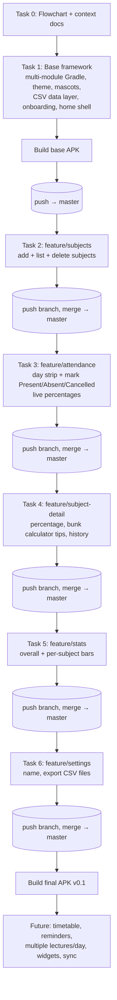
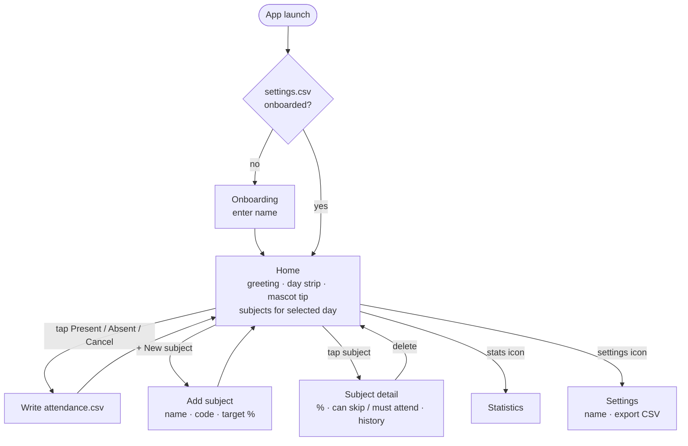
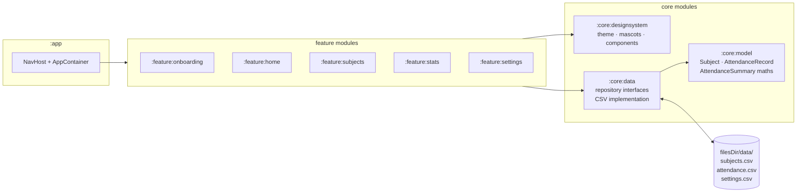

# Attendo — Flowcharts

GitHub renders these Mermaid diagrams directly.

## 1. Delivery plan (one task = one branch = one push)

## 2. App navigation

## 3. Architecture / data flow

Screens follow **Route → ViewModel → StateFlow&lt;UiState&gt; → stateless Screen**. Features only see repository
interfaces, so the CSV storage can later be replaced (Room, cloud sync) without UI changes.
